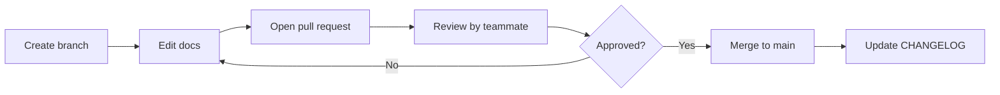

# Contributing to NMS

This repository holds the working documents of the NMS team. Please follow these rules so the content stays consistent and easy to review.

## Ground Rules

1. Never commit directly to `main`. Use a branch and open a pull request.
2. Every pull request needs at least one reviewer from the team.
3. Keep one topic per pull request.
4. Do not include personal data of students, mentors or companies (phone numbers, emails, resumes, scores).
5. Do not claim placement guarantees anywhere. See [ADR 0001](docs/decisions/0001-no-placement-guarantee.md).
6. Mention a company name only when the claim is verified and truthful.
7. The business model scope excludes web application or product features.

## Branch Naming

| Type | Pattern | Example |
|---|---|---|
| Content | `docs/<topic>` | `docs/mechanical-track-update` |
| Decision | `decision/<number>-<topic>` | `decision/0002-target-year` |
| Fix | `fix/<topic>` | `fix/pricing-typo` |
| Structure | `chore/<topic>` | `chore/add-templates` |

## Commit Messages

Use short, clear messages in the form `type: summary`.

```text
docs: add mock interview rubric to common modules
fix: correct week count in cohort timeline
decision: record target year as final year
```

## Writing Style

| Rule | Detail |
|---|---|
| Tone | Casual Hinglish is fine for internal docs. Keep structure professional. |
| Emojis | Not used. |
| Tables | Use for comparisons, phases and metrics. |
| Diagrams | Use Mermaid only. Do not paste image screenshots of diagrams. |
| File names | Lowercase with hyphens, for example `go-to-market.md`. |
| Headings | One H1 per file. Do not skip heading levels. |

## Pull Request Flow



## Recording Decisions

For any decision that changes scope, pricing, tracks or policy, copy `docs/decisions/ADR-TEMPLATE.md`, number it in sequence and link it from the pull request.

## Questions

Open an issue using the `task` or `decision-request` template.
