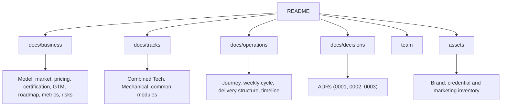

# Overview

## Idea in One Minute

NMS (No More Struggle) is an instructor-led placement cohort powered by a 24/7 AI Assistant and supported by recently placed graduates. It targets 250 to 300 students in Cohort 1 across two parallel streams: a **Combined Tech Track** (CS/IT, BCA, MCA) and an **Independent Mechanical Track**. Content is current, advice is first-hand, and practice is continuous through teacher masterclasses and AI-driven personalized feedback.

We operate two distinct streams:

| Track Stream | Included Students | Focus & Delivery |
|---|---|---|
| **Combined Tech Track** | B.Tech CS/IT, BCA, and MCA students | Unified programming and DSA curriculum with baseline leveling, core CS, web/system projects, and off-campus strategies. Runs together. |
| **Mechanical Track** | B.Tech Mechanical students | Runs **separately**. Core mechanical subjects, design/CAD tools, technical aptitude, company test simulations, and core interview mocks. |

## Target Audience Breakdown

| Priority | Target Year | Primary Objective |
|---|---|---|
| **Primary (70–80%)** | 2nd & 3rd Year | Long preparation runway, strong DSA/core foundations, internship preparation, on-campus drive readiness. |
| **Secondary (20–30%)** | 4th Year & 1st Year | 4th years: urgent placement recovery and off-campus sprint. 1st years: early programming foundations and logic building. |

## Tagline

Hum wahi hain jo kal tak aapki jagah the.

## Core Principles

| Principle | Meaning |
|---|---|
| **Teacher + AI Assistant** | Masterclasses by experienced lead teachers paired with a 24/7 AI assistant for instant doubt resolution and code feedback. |
| **Scale Without Dilution** | 250–300 cohort capacity organized into stream-level masterclasses and automated personal assessment. |
| **Recent experience** | Mentors and interviewers are recently placed and know current recruitment patterns. |
| **Continuous feedback** | 24/7 AI code reviews and weekly live mock interviews with written scorecards. |
| **Weekly rhythm** | Fixed weekly schedule so students develop discipline and stay accountable. |
| **Verifiable Credentials** | Certificate of Completion with unique verification ID under Udyam MSME registration, scaling toward College MoUs and AICTE/NSDC pathways. |
| **Honesty** | Roadmap, metric tracking, and skill building—never an empty placement guarantee. |

## How the Repository Is Organized

## Scope

In scope: cohort business model, curriculum, operations, launch plan, metrics and risks.

Out of scope: web application or product features. These are discussed separately and are not part of this model yet.

## Living Document

All files are updated as decisions are finalized. Notable changes are recorded in the [CHANGELOG](../CHANGELOG.md).
