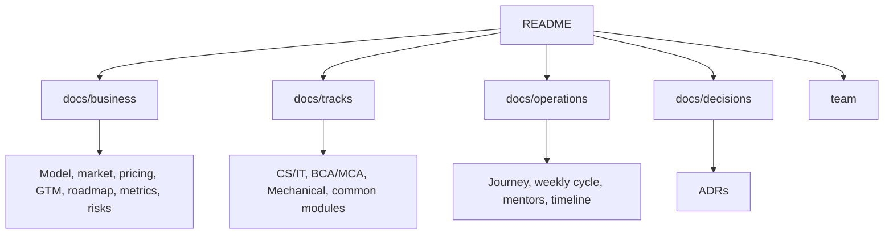

# Overview

## Idea in One Minute

NMS (No More Struggle) is a small, mentor-led placement cohort run by people who have recently gone through the placement process. Content is current, advice is first-hand and feedback is based on real interviews.

We start with three tracks.

| Track | Target students | Focus |
|---|---|---|
| CS/IT | B.Tech CS, IT and allied branches | DSA, core CS, projects, interviews |
| BCA/MCA | BCA and MCA students | Programming base, confidence, off-campus strategy |
| Mechanical | B.Tech Mechanical | Core subjects, design tools, company tests, interviews |

## Tagline

Hum wahi hain jo kal tak aapki jagah the.

## Core Principles

| Principle | Meaning |
|---|---|
| Recent experience | Mentors are recently placed and remember the process |
| Small batches | 15 to 20 students, 1 mentor per 4 to 5 students |
| Personal feedback | Written and recorded, not generic group feedback |
| Weekly rhythm | Fixed schedule so students know what happens when |
| Honesty | Roadmap and tracking, never a placement guarantee |

## How the Repository Is Organized

## Scope

In scope: cohort business model, curriculum, operations, launch plan, metrics and risks.

Out of scope: web application or product features. These are discussed separately and are not part of this model yet.

## Living Document

All files are updated as decisions are finalized. Notable changes are recorded in the [CHANGELOG](../CHANGELOG.md).
