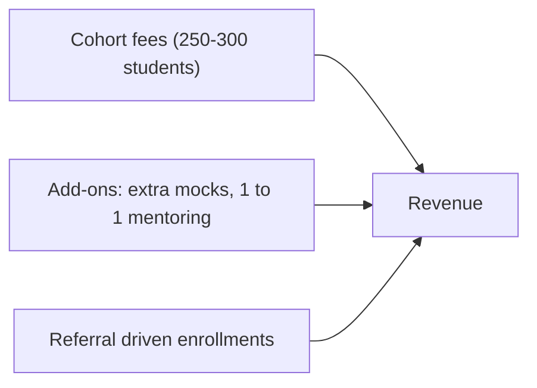

# Business Model

## Problem

Many placement courses are taught by trainers who are far from the current hiring process. Batches are large, feedback is generic and non-CS branches are largely ignored. Students end up struggling alone.

## Solution

A high-accountability placement cohort for 250 to 300 students delivered via a **Teacher + AI Assistant hybrid model**. Masterclasses are conducted by experienced lead teachers, while a 24/7 AI Assistant provides instantaneous code reviews, conceptual doubt resolution, and mock drill feedback. The program runs two streams: a **Combined Tech Track (CS/IT, BCA/MCA)** and an **Independent Mechanical Track**.

## Why Us?

| Point | Typical Coaching | Massive MOOCs | NMS |
|---|---|---|---|
| Delivery & Mentorship | Trainer with outdated syllabus | Pre-recorded videos, no live guidance | **Lead Teacher masterclasses + 24/7 AI Assistant** |
| Doubt Resolution | Slow, limited to class time | Forum-based, slow or ignored | **Instant, 24/7 interactive AI guidance + Teacher Q&A** |
| Cohort Scale | 100+ crowded room | 1,000+ anonymous learners | **250–300 cohort organized into focused streams** |
| Feedback | Generic, in group | Automated multiple-choice only | **Line-by-line AI code analysis + live mock interviews with written scorecards** |
| Branch Coverage | Mostly CS/IT only | Generic software tracks | **Combined Tech Track + Dedicated Separate Mechanical Track** |
| Interview Practice | Occasional or none | None | **Weekly mock interview rounds with rubric-based feedback** |
| Promises | "100% placement guarantee" | Completion certificate only | **Honest skill tracking, portfolio building, no fake guarantees** |

### Ready Answer

> We combine the depth of experienced teacher-led masterclasses with the 24/7 responsiveness of an AI assistant. Whether in our combined Tech stream or our dedicated Mechanical stream, students get daily accountability, instant code feedback, and weekly live mocks without false placement promises.

## Value Proposition by Stream

| Stream | Who It Serves | What They Get |
|---|---|---|
| **Combined Tech Track** | B.Tech CS/IT, BCA, and MCA (2nd, 3rd, and select 4th/1st years) | Unified DSA progression (baseline leveling for BCA/beginners, advancing to complex problem-solving), core CS fundamentals, system/web projects, and off-campus strategies. |
| **Mechanical Track** | B.Tech Mechanical (Runs separately) | Core mechanical revision (Thermodynamics, SOM, Fluid, Manufacturing, Design), CAD/tools orientation, company test patterns, core interview mocks, and an optional tech/analytics bridge. |

## Revenue Streams

| Stream | Description | Status |
|---|---|---|
| Cohort fees | Main revenue from Cohort 1 (250 to 300 students) | Price to be fixed after survey |
| Add-ons | Extra live mocks and 1-on-1 mentor deep dives | Optional |
| Referral discount | Benefit for student-to-student peer recommendations | Growth lever |

## Key Activities

1. Conduct live masterclasses and core concept sessions (Tue/Wed)
2. Deploy and maintain the 24/7 AI Assistant for code feedback, error debugging, and instant doubt clearing
3. Conduct weekly coding/core assessments (Friday) and mock interviews (Saturday)
4. Maintain the Placement Playbook with verified company interview questions
5. Provide resume/LinkedIn overhauls and off-campus application guidance

## Key Resources

| Resource | Notes |
|---|---|
| Lead Teachers | Experienced instructors leading core tracks and live lectures |
| AI Assistant Platform | 24/7 intelligent code review, doubt clearing, and mock drill engine |
| Mock Evaluators | Recently placed alumni conducting Saturday live mocks |
| Placement Playbook | Verified, company-specific interview patterns and questions |
| Question banks & rubrics | Calibrated tests and standard evaluation matrices |

## Cost Drivers

Lead teacher compensation, mock evaluator stipends, AI API/token usage and platform hosting, marketing/outreach, payment gateway fees (2–3%), and legal/tax compliance.

## Unfair Advantages

1. **Teacher + AI Assistant efficiency:** Scales to 250–300 students with immediate 24/7 personal feedback at accessible price points.
2. **Dedicated Mechanical Track:** Caters to a massive, underserved engineering segment that generic coding bootcamps ignore.
3. **Combined Tech Stream:** Levels up BCA/MCA and CS/IT students together while allowing adaptive pacing.
4. **Honest positioning:** Zero fake guarantees, backed by real interview data and continuous skill tracking.
