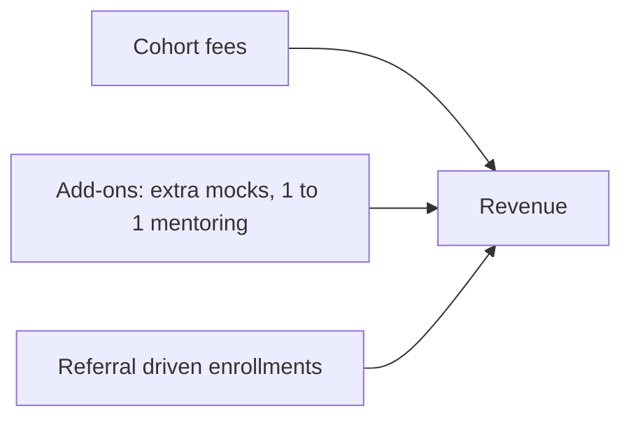

# Business Model

## Problem

Many placement courses are taught by trainers who are far from the current hiring process. Batches are large, feedback is generic and non-CS branches are largely ignored. Students end up struggling alone.

## Solution

A small cohort program led by recently placed graduates, with weekly mock interviews, personal feedback and accountability, covering CS/IT, BCA/MCA and Mechanical.

## Why Us?

| Point | Typical Coaching | NMS |
|---|---|---|
| Mentor background | Trainer who may be far from the placement process | Recently placed people who still remember the process |
| Batch size | 100+ students | 15 to 20 students |
| Feedback | Generic, in group | Personal, written and recorded |
| Branch coverage | Mostly CS/IT | CS/IT, BCA/MCA and Mechanical |
| Interview practice | Occasional | Mock interview every week |
| Accountability | Student manages alone | Weekly targets and review |
| Promises | "100 percent placement" | Honest roadmap, no guarantee |

### Ready Answer

> We are not a traditional institute. We are recently placed graduates from both CS and Mechanical backgrounds. The roadmap we followed ourselves is what we teach, in small batches with personal feedback.

## Value Proposition by Segment

| Segment | What they get |
|---|---|
| CS/IT | Structured DSA and core CS prep with realistic mocks |
| BCA/MCA | Strong foundations first, then speed and an off-campus strategy |
| Mechanical | Core revision, tools orientation, company test practice, optional IT/analytics bridge |

## Revenue Streams

| Stream | Description | Status |
|---|---|---|
| Cohort fees | Main revenue from standard cohorts | Price to be fixed after survey |
| Add-ons | Extra mocks and 1 to 1 mentoring | Optional |
| Referral discount | Benefit for bringing friends | Growth lever, not a major revenue line |

## Key Activities

1. Run weekly concept sessions, practice and mini tests
2. Conduct weekly mock interviews with written feedback
3. Maintain the Placement Playbook of real interview experiences
4. Provide resume and LinkedIn makeovers
5. Support applications and interview preparation

## Key Resources

| Resource | Notes |
|---|---|
| Mentors | Recently placed, grouped by track |
| Placement Playbook | Real, verified interview experiences |
| Question banks and test sets | Per track |
| Feedback format | Standard across tracks |

## Cost Drivers

Mentor time, tools and platform subscriptions, marketing, payment fees, and legal and tax compliance. Detailed numbers will be added after pricing is finalized.

## Unfair Advantages

1. Mechanical track in a segment with few serious players
2. Mentors with fresh, first-hand interview experience
3. Honest positioning with no guarantee claims
