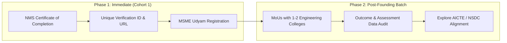

# Certification and Accreditation Strategy

This document outlines the credentialing and institutional recognition roadmap for NMS cohorts, balancing immediate agility with long-term institutional trust.

---

## 1. Phase 1: Current / Founding Batch (Abhi)

For Cohort 1, certification focuses on tamper-evident, verifiable proof of skills and legal institutional backing under MSME.

### A. NMS Certificate of Completion with Verification ID
* **Unique Credential ID:** Every certificate carries a unique identifier (e.g., `NMS-2026-C1-XXXX`) and a verification QR/URL link.
* **Online Verification:** Employers and recruiters can verify candidate credentials, track completion, and assessment scores on a dedicated lookup page.
* **Eligibility & Exit Criteria:**
  1. Minimum 80% attendance in live masterclasses and recorded review checks.
  2. Completion of all weekly coding/core assessments.
  3. Minimum 4 live weekend mock interviews completed with passing rubric marks.
  4. Verified project submission / code repository review.

### B. Udyam Registration (Ministry of MSME, Govt. of India)
* NMS is registered under the **Udyam Registration Portal** as an MSME entity.
* Udyam registration provides recognized legal entity standing, enables formal commercial invoicing, and builds foundational regulatory trust with students, parents, and payment gateways.
* All certificates will cite the legal entity and Udyam Registration number for transparency.

---

## 2. Phase 2: Post-Founding Batch (Scaling & Institutional Recognition)

Following the completion of Cohort 1 and the collection of verified outcome data, NMS will expand into institutional and national skilling frameworks.

### A. College Institutional Partnerships (MoUs)
* **Target:** Sign formal Memorandums of Understanding (MoUs) with **1 to 2 engineering/technical colleges**.
* **Value for Colleges:** Provides their pre-final and final-year students (2nd, 3rd, and 4th years) with structured placement training, 24/7 AI-assisted doubt clearing, and verified mock interviews without overloading internal placement cell faculty.
* **Structure:** Co-branded certification ("NMS in collaboration with [College Name] Placement Cell").

### B. AICTE / NSDC Skilling Route Exploration
* **Leveraging Track Record:** Use audited baseline-to-exit score improvements, placement conversion rates, and real-world placement playbook metrics from Cohort 1.
* **AICTE (All India Council for Technical Education):** Explore recognition through the NEAT (National Educational Alliance for Technology) portal or student internship/training partnership schemes.
* **NSDC (National Skill Development Corporation):** Explore alignment with National Occupational Standards (NOS) and Qualification Packs (QP) via IT-ITeS SSC (NASSCOM) and Automotive/Capital Goods Sector Skill Councils for the Mechanical track.

---

## Credential Architecture Comparison

| Level | Credential Issued | Governing / Verifying Body | Status |
|---|---|---|---|
| **Immediate (Cohort 1)** | NMS Certificate of Completion with Verification ID | NMS (under Udyam MSME Registration) | **Active for Cohort 1** |
| **Institutional (Post-Cohort 1)** | Co-Branded Cohort Placement Certificate | Partner Colleges (via MoU) + NMS | **Planning for Cohort 2** |
| **National (Long-term)** | Government Skilling Aligned Credential | AICTE (NEAT) / NSDC Sector Skill Council | **Exploratory Post-Cohort 1** |

---

## Verification Verification Checklist

- [ ] Unique verification ID format standardized
- [ ] Online verification lookup endpoint/page established
- [ ] Udyam registration completed and registration number displayed
- [ ] Transparent criteria published: certificates awarded only on merit and completion, never on enrollment alone

