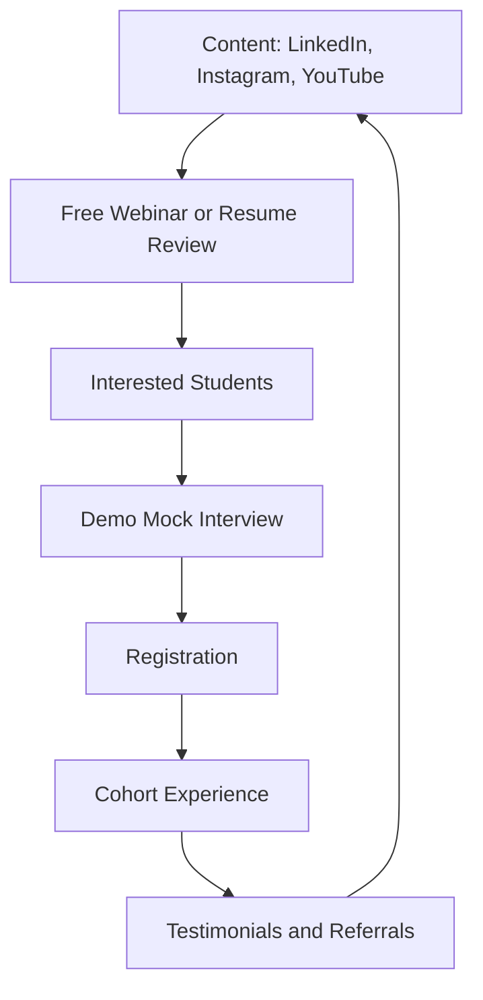

# Go-to-Market

## Growth Funnel

## Channels

| Channel | Use | Content examples |
|---|---|---|
| LinkedIn | Credibility, professional outcomes, mentor stories | Interview experience breakdowns, resume before/afters, verified placement advice |
| Instagram | Reach among 2nd & 3rd year college students | Short concept reels, DSA pattern breakdowns, mock interview clips (with consent) |
| YouTube | Educational depth and algorithmic walkthroughs | Stream roadmaps, live masterclass teasers, mentor career journeys |
| College communities | Direct campus penetration | Free webinars, coding bootcamps, campus ambassador networks (laying groundwork for college MoUs) |
| Referrals | Organic word-of-mouth | Referral discounts for enrolled peers |

## Trust Building

1. Free live resume reviews and ATS score checks
2. Free demo mock interviews showcasing the standardized rubric
3. Transparent lead teacher and mentor credentials
4. Legal backing via **Udyam MSME Registration** and verifiable credential lookup
5. Transparent outcome tracking—strictly avoiding false placement guarantees (ADR 0001)

## Target Audience Targeting Strategy

Outreach campaigns specifically focus on **2nd and 3rd year students (70–80% of cohort target)** across engineering colleges and BCA/MCA institutions, emphasizing early preparation for internships and 7th-semester campus drives, while offering fast-track support for 4th years and foundational bootcamps for 1st years.

## Content Pillars

| Pillar | Description |
|---|---|
| Roadmaps | Track-wise preparation paths |
| Real experiences | Verified interview stories from mentors |
| Resume makeovers | Before and after examples |
| Mistakes and lessons | What mentors did wrong and fixed |

## Rules

1. Use company names only when verified and truthful
2. Get written consent before sharing any student content
3. No guarantee language in any post or ad
4. Keep claims measurable and honest

## Metrics

Leads per channel, free session attendance, demo-to-registration conversion and referral rate. See [metrics](metrics.md).
