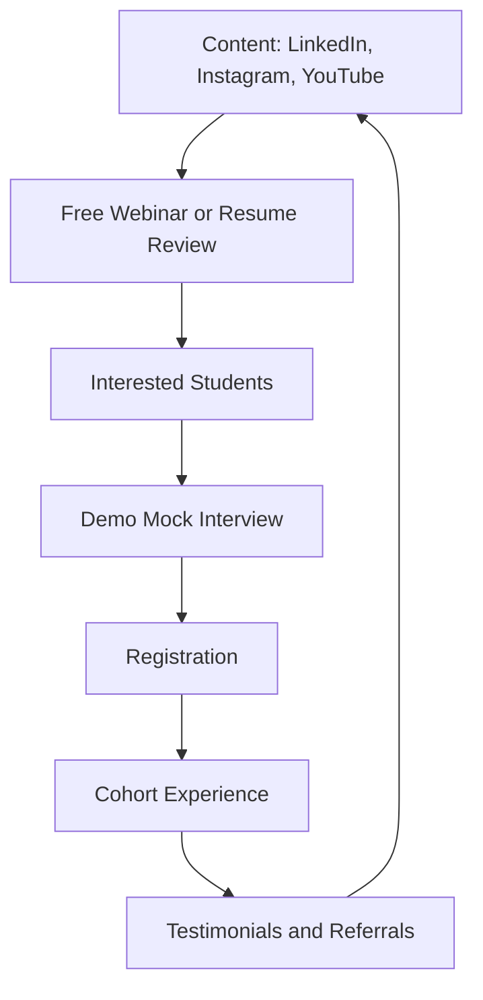

# Go-to-Market

## Growth Funnel

## Channels

| Channel | Use | Content examples |
|---|---|---|
| LinkedIn | Credibility, mentor profiles | Interview experience posts, resume before and after |
| Instagram | Reach among students | Short tips, mock interview clips (with consent) |
| YouTube | Depth and trust | Track roadmaps, mentor interviews |
| College communities | Direct access | Free sessions, placement cell collaboration |
| Referrals | Low-cost growth | Referral discount |

## Trust Building

1. Free resume reviews
2. Free demo mock interview
3. Transparent mentor profiles with verified claims
4. Founding batch testimonials with consent
5. Public, honest outcome tracking

## Content Pillars

| Pillar | Description |
|---|---|
| Roadmaps | Track-wise preparation paths |
| Real experiences | Verified interview stories from mentors |
| Resume makeovers | Before and after examples |
| Mistakes and lessons | What mentors did wrong and fixed |

## Rules

1. Use company names only when verified and truthful
2. Get written consent before sharing any student content
3. No guarantee language in any post or ad
4. Keep claims measurable and honest

## Metrics

Leads per channel, free session attendance, demo-to-registration conversion and referral rate. See [metrics](metrics.md).
