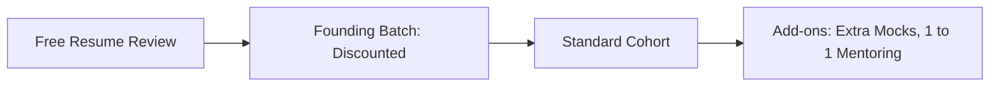

# Pricing

> Status: price points are intentionally not fixed. Decide after a short student survey.

## Pricing Ladder

| Stage | Purpose | Note |
|---|---|---|
| Free resume review | Build trust and collect leads | Reach as many students as possible |
| Founding batch (Cohort 1) | Testimonials, case studies, and audited outcomes | Discounted introductory pricing for 250 to 300 students (ADR 0002) |
| Standard cohort (Cohort 2+) | Sustainable revenue and college MoU cohorts | Fix price after survey and Cohort 1 review |
| Add-ons | Extra income and specialized 1-on-1 support | Optional |
| Referral discount | Organic peer-to-peer growth | Benefit for bringing friends |

## Survey Questions (Draft)

1. Branch (CS/IT, BCA, MCA, or Mechanical) and academic year (1st, 2nd, 3rd, or 4th)
2. Biggest placement challenge (DSA, Core engineering, communication, or aptitude)
3. What would you pay for a 12-week cohort with weekly live masterclasses, 24/7 AI assistance, weekly mocks, and verified completion certification? (range options)
4. Preferred timing: weekday evening or weekend
5. Would you join a free resume review or demo mock interview?

## Guidelines

1. Cap the founding batch strictly at 250 to 300 seats and clearly label it as Founding Cohort 1
2. Be completely transparent about what is included (curriculum, 24/7 AI assistance, weekend live mocks, verifiable certificate)
3. Offer a clear refund policy, formalized with legal advice
4. Do not link fees to placement outcomes or make false 100% placement claims (ADR 0001)

## Income-Share or Placement-Linked Fees

Not recommended. It carries legal, ethical, and trust risks and implies an outcome guarantee. See [ADR 0001](../decisions/0001-no-placement-guarantee.md).

## Add-ons

| Add-on | Description |
|---|---|
| Extra mock interviews | Additional live recorded mocks with written feedback rubric |
| 1 to 1 mentor deep-dives | Dedicated 1-on-1 sessions with track leads |
| Resume deep dive | Extended resume and LinkedIn review |

## Open Items

1. Survey results and willingness to pay bands
2. Price per stream (Combined Tech vs Mechanical), if differentiated
3. Refund and cancellation policy
4. Payment gateway integration (Razorpay/Cashfree under MSME Udyam registration)
