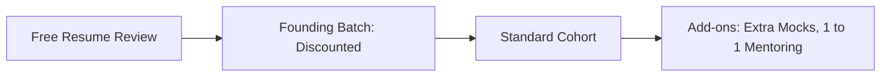

# Pricing

> Status: price points are intentionally not fixed. Decide after a short student survey.

## Pricing Ladder

| Stage | Purpose | Note |
|---|---|---|
| Free resume review | Build trust and collect leads | Reach as many students as possible |
| Founding batch | Testimonials and case studies | Low price, limited seats |
| Standard cohort | Main revenue | Fix price after survey |
| Add-ons | Extra income and personal support | Optional |
| Referral discount | Organic growth | Benefit for bringing friends |

## Survey Questions (Draft)

1. Branch and year
2. Biggest placement challenge
3. What would you pay for a 12-week cohort with weekly mocks? (range options)
4. Preferred timing: weekday evening or weekend
5. Would you join a free resume review?

## Guidelines

1. Keep the founding batch seats limited and clearly labelled
2. Be transparent about what is included
3. Offer a clear refund policy, decided with legal advice
4. Do not link fees to placement outcomes

## Income-Share or Placement-Linked Fees

Not recommended at this stage. It carries legal, ethical and trust risks and implies a guarantee. See [ADR 0001](../decisions/0001-no-placement-guarantee.md).

## Add-ons

| Add-on | Description |
|---|---|
| Extra mock interviews | Additional recorded mocks with written feedback |
| 1 to 1 mentoring | Dedicated mentor sessions |
| Resume deep dive | Extended resume and LinkedIn review |

## Open Items

1. Survey results
2. Price per track, if different
3. Refund and cancellation policy
4. Payment collection method
