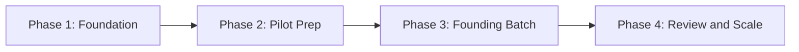

# Launch Roadmap

| Phase | Time | What to do |
|---|---|---|
| Foundation | Week 1 to 2 | Finalize tracks, mentors, branding and pricing approach |
| Pilot Prep | Week 3 to 4 | Build the playbook, set up tools, run free sessions |
| Founding Batch | Week 5 to 16 | Run the first cohort and collect feedback |
| Review and Scale | After batch | Review results, improve content, adjust price and add batches |

## Phase Checklists

### Phase 1: Foundation

- [ ] Final name, logo and tagline
- [x] Target year decided (2nd & 3rd year primary, plus 4th & 1st year) — ADR 0002
- [x] Stream model finalized (Combined Tech + Independent Mechanical) — ADR 0002
- [x] Delivery architecture decided (Lead Teacher + AI Assistant + Mock Evaluators) — ADR 0002
- [x] Certification & compliance roadmap accepted — ADR 0003
- [ ] Student survey drafted and shared for pricing validation
- [ ] Udyam Registration (MSME, Govt. of India) completed
- [ ] Business bank account and payment collection set up

### Phase 2: Pilot Prep

- [ ] Placement Playbook first version
- [ ] Question banks per stream (Tech and Mechanical)
- [ ] AI Assistant integration configured (24/7 doubt bot & code review prompts)
- [ ] Unique Verification ID format and certificate validation lookup page built
- [ ] Feedback rubric and mock interview schedule tool set up
- [ ] Platform and community channel chosen (Discord/Slack/LMS)
- [ ] Free resume review and outreach webinar for 2nd/3rd years

### Phase 3: Founding Batch (Cohort 1: 250 to 300 Students)

- [ ] Cohort 1 registrations opened for 250 to 300 seats
- [ ] Baseline diagnostic test completed across streams
- [ ] Weekly cycle running (masterclasses, 24/7 AI doubts, Fri tests, Sat mocks)
- [ ] Mid-batch feedback collected
- [ ] Final assessment completed
- [ ] NMS Certificates of Completion issued with unique Verification IDs under Udyam registration

### Phase 4: Review and Scale (Institutional Recognition)

- [ ] Results analysed against metrics (baseline vs final scores, mock ratings)
- [ ] Testimonials and placement case studies collected with consent
- [ ] Institutional MoUs signed with 1 or 2 engineering colleges for co-branded cohorts
- [ ] Explore formal alignment with AICTE (NEAT) and NSDC Sector Skill Councils using verified Cohort 1 outcome data
- [ ] Content improved and next batch scaled

## Dependencies

Pricing depends on student survey results. Track resource allocation depends on registration distribution between the Combined Tech and Mechanical streams. Institutional scaling depends on audited outcomes from Cohort 1.
