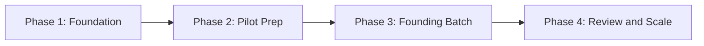

# Launch Roadmap

| Phase | Time | What to do |
|---|---|---|
| Foundation | Week 1 to 2 | Finalize tracks, mentors, branding and pricing approach |
| Pilot Prep | Week 3 to 4 | Build the playbook, set up tools, run free sessions |
| Founding Batch | Week 5 to 16 | Run the first cohort and collect feedback |
| Review and Scale | After batch | Review results, improve content, adjust price and add batches |

## Phase Checklists

### Phase 1: Foundation

- [ ] Final name, logo and tagline
- [ ] Mentors assigned per track
- [ ] Target year decided
- [ ] Student survey drafted and shared
- [ ] Business structure and payment method explored

### Phase 2: Pilot Prep

- [ ] Placement Playbook first version
- [ ] Question banks per track
- [ ] Feedback format finalized
- [ ] Platform and community channel chosen
- [ ] Free resume review and webinar scheduled

### Phase 3: Founding Batch

- [ ] Registrations closed with limited seats
- [ ] Baseline test completed
- [ ] Weekly cycle running
- [ ] Mid-batch feedback collected
- [ ] Final assessment completed

### Phase 4: Review and Scale

- [ ] Results analysed against metrics
- [ ] Testimonials and case studies collected with consent
- [ ] Content improved
- [ ] Price and batch size reviewed
- [ ] Next batch planned

## Dependencies

Pricing depends on survey results. Timeline depends on target year. Mentor allocation depends on registrations per track.
