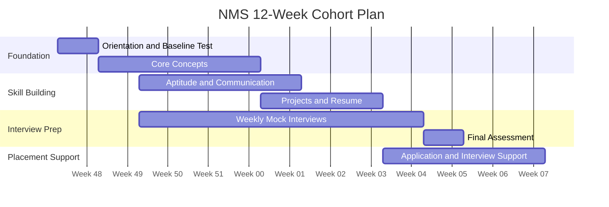

# 12-Week Cohort Timeline

Dates are examples only. Update them to the actual batch start date.

## Phase Summary

| Phase | Weeks (approx.) | Focus |
|---|---|---|
| Foundation | 1 to 5 | Orientation, baseline, core concepts |
| Skill Building | 3 to 8 | Aptitude, communication, projects, resume |
| Interview Prep | 3 to 11 | Weekly mocks, final assessment |
| Placement Support | 8 to 12 | Applications and interview support |

## Notes

Phases overlap by design. Adjust depth per track using baseline results. The timeline will be refined once the target year is decided.
