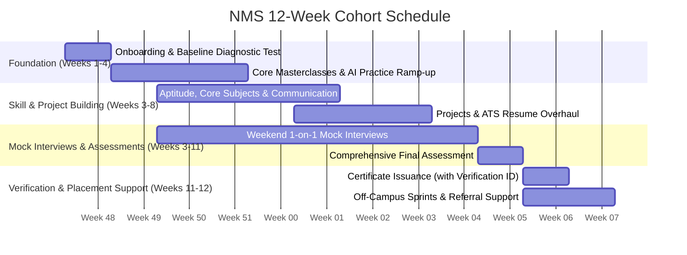

# 12-Week Cohort Timeline

Dates are indicative for Cohort 1 (founding batch of 250 to 300 students).

## Phase Summary

| Phase | Weeks | Focus & Deliverables | Primary Actors |
|---|---|---|---|
| **Foundation** | 1 to 4 | Onboarding, baseline diagnostic tests, programming ramp-up, core concept masterclasses | Lead Teachers & AI Assistant |
| **Skill & Project Building** | 3 to 8 | Aptitude drills, core CS / Mechanical subjects, project architecture, ATS resume review | Lead Teachers, AI Assistant, Evaluators |
| **Interview Prep** | 3 to 11 | Weekly weekend 1-on-1 mocks with rubric scoring, timed coding OA simulations, comprehensive final assessment | Mock Evaluators & AI Assistant |
| **Verification & Placement** | 11 to 12 | **NMS Certificate of Completion** issuance with unique Verification IDs under Udyam MSME registration, off-campus application sprint, and referral support | Operations & Lead Teachers |

## Cohort Notes

1. **Target Audience Alignment (ADR 0002):** The 12-week depth is calibrated primarily for **2nd and 3rd year students** preparing for upcoming internship and on-campus drive cycles, while accommodating **4th years** on fast-track off-campus sprints and **1st years** building foundations.
2. **Parallel Streams:** Masterclasses run in parallel for the **Combined Tech Track** (CS/IT, BCA, MCA) and the **Mechanical Track** (independent core curriculum).
3. **Continuous AI Support:** 24/7 AI-driven assistance runs uninterrupted throughout all 12 weeks for instantaneous code debugging, doubts, and mock drills.
