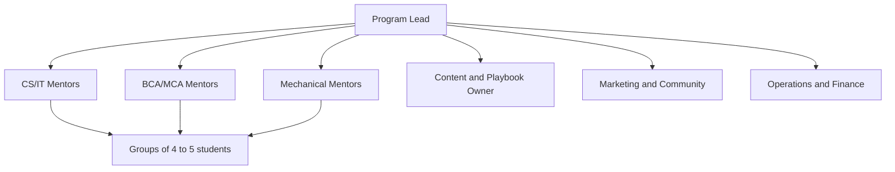

# Mentor Structure

## Rule of Thumb

One mentor handles 4 to 5 students. This protects personal attention and quality of feedback.

## Capacity Planning

| Batch size | Mentors needed (at 4 to 5 per mentor) |
|---|---|
| 15 | 3 to 4 |
| 20 | 4 to 5 |

Capacity is planned per track based on registrations.

## Mentor Standards

1. Recently placed and able to share verified experience
2. Uses the standard feedback format and mock rubric
3. Attends the weekly review
4. Has a named backup mentor for absences
5. Follows the claims policy and the code of conduct

## Backup and Continuity

| Risk | Plan |
|---|---|
| Mentor unavailable | Backup mentor takes over the group |
| Missed session | Recording shared |
| Schedule clash | Fixed weekly slots set at the start of the cohort |
