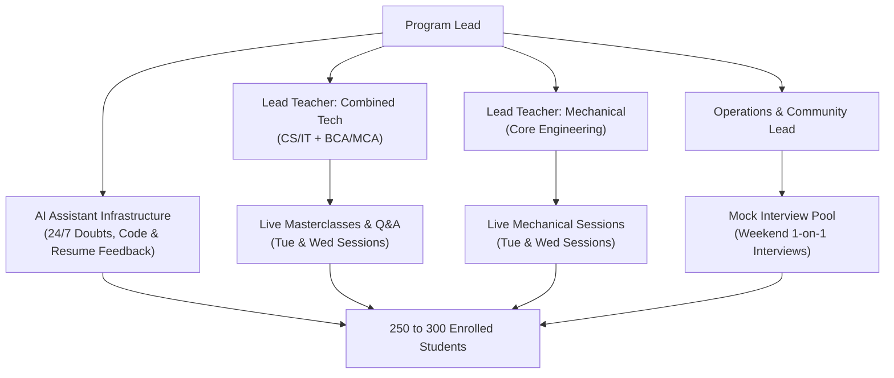

# Delivery and Mentorship Structure

NMS combines **Lead Teacher masterclasses** with a **24/7 AI Assistant** and a pool of **Mock Interviewers** to deliver personalized attention to a cohort of 250 to 300 students without operational breakdown.

## The Hybrid Delivery Model

| Role | Primary Responsibilities | Scaling Mechanism |
|---|---|---|
| **Lead Teacher(s)** | Core curriculum design, live concept masterclasses, problem-solving breakdowns, high-level AMA/doubt sessions. | 1 Lead Teacher per track (Tech vs Mechanical) delivers live interactive lectures to the batch. |
| **24/7 AI Assistant** | Continuous syntax & logic debugging, conceptual doubt clearing, diagnostic test evaluation, automated ATS resume scanning, practice mock interview drills. | Infinite horizontal scale: answers student queries 24/7 in real time. |
| **Mock Interviewers / Evaluators** | Conduct 1-on-1 technical and HR mock interviews on weekends, fill standardized rubric sheets, provide live verbal feedback. | Flexible pool of recently placed graduates deployed on weekend shifts. |
| **Operations Lead** | Student onboarding, attendance tracking, mock slot scheduling, community moderation, and platform management. | Supported by automated scheduling tools (e.g., Cal.com/Calendly) and batch management bots. |

## Capacity Planning (Cohort 1: 250 to 300 Students)

Assuming a typical distribution:
- **Combined Tech Stream (CS/IT, BCA, MCA):** ~170 to 200 students
- **Mechanical Stream:** ~80 to 100 students

| Resource / Function | Allocation for 250–300 Students | Notes |
|---|---|---|
| **Tech Lead Teacher** | 1 Primary (+ 1 Backup / Guest) | Delivers 2 live concept sessions/week + 1 doubt clinic |
| **Mechanical Lead Teacher** | 1 Primary (+ 1 Backup / Guest) | Delivers 2 core engineering sessions/week + 1 doubt clinic |
| **AI Assistant Infrastructure** | Always-on (Discord/Web interface) | Handles 80%+ of recurring coding, syntax, and logic doubts |
| **Mock Interviewers** | 12 to 15 active evaluators | Each interviewer takes 4–5 mocks per weekend (2–3 hours commitment) across Friday evening, Saturday, and Sunday |
| **Operations & TA Support** | 1 Operations Lead + 2 Student TAs | Manages slots, leaderboard, attendance, and escalations |

## Evaluator and Mentor Standards

1. Recently placed graduate or working professional with verified industry experience.
2. Uses the standard NMS mock rubric and written feedback template.
3. Submits feedback sheets within 12 hours of the mock session.
4. Operates with named backups to ensure zero student slot cancellations.
5. Strictly adheres to the claims policy, honesty guidelines, and code of conduct.

## Continuity and Fail-safes

| Risk | Mitigation |
|---|---|
| Lead teacher illness / absence | Co-lead or pre-recorded deep-dive + live TA office hours |
| Mock interviewer no-show | Standby backup interviewers on weekend roster |
| High AI query load / edge case doubts | Escalation channel tagged for teacher review during Thursday clinics |
| Slot clashes for college exams | Flexible mock scheduling window (Fri evening through Sunday) |
