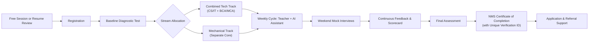

# Student Journey

## Stages

| Stage | Description | Owner |
|---|---|---|
| Discovery | Free session or resume review | Marketing and Community |
| Registration | Form, onboarding, fee processing | Operations and Finance |
| Baseline test | Diagnostic for skill leveling and tracking progress | Lead Teachers & AI Assistant |
| Stream allocation | Enrolled in Combined Tech or Independent Mechanical | Program Lead |
| Weekly cycle | Concepts, 24/7 AI practice, mini-tests, mock drills | Lead Teachers & AI Assistant |
| Mock interviews | Weekend 1-on-1 interviews with standard rubric | Mock Evaluators |
| Final assessment | Comprehensive final test compared against baseline | Lead Teachers & AI Assistant |
| **Certification** | Issuance of **NMS Certificate of Completion** with unique **Verification ID** under Udyam registration (ADR 0003) | Operations & Technology |
| Application support | ATS resume polish, referral templates, off-campus sprints | Lead Teachers & Evaluators |

## Certification Issuance Criteria

To receive the verified certificate, students must meet:
1. Minimum 80% attendance/engagement across weekly cycles.
2. Submission of all weekly mini-tests and coding assignments.
3. Completion of at least 4 live 1-on-1 mock interviews with passing rubric remarks.
4. Demonstrated score improvement on the final assessment compared to baseline.

## Onboarding Checklist

- [ ] Registration complete
- [ ] Consent for recordings collected
- [ ] Baseline test taken
- [ ] Track and mentor group assigned
- [ ] Weekly schedule shared
- [ ] Accountability group introduced
