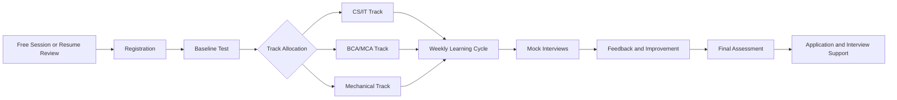

# Student Journey

## Stages

| Stage | Description | Owner |
|---|---|---|
| Discovery | Free session or resume review | Marketing and Community |
| Registration | Form and onboarding | Operations |
| Baseline test | Diagnostic for track allocation and tracking progress | Track mentors |
| Track allocation | Student placed in CS/IT, BCA/MCA or Mechanical | Program Lead |
| Weekly cycle | Concepts, practice, tests, mocks, review | Mentors |
| Final assessment | Compare against baseline | Track mentors |
| Application support | Resume, referrals, interview prep | Mentors |

## Onboarding Checklist

- [ ] Registration complete
- [ ] Consent for recordings collected
- [ ] Baseline test taken
- [ ] Track and mentor group assigned
- [ ] Weekly schedule shared
- [ ] Accountability group introduced
