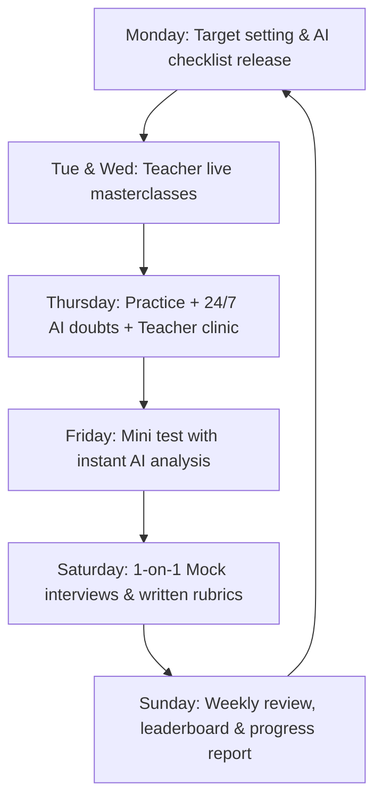

# Weekly Cycle

The weekly cycle provides a consistent, disciplined rhythm for the cohort. It blends **Lead Teacher instruction**, **24/7 AI-assisted practice**, and **weekend live mock evaluations**.

| Day | Activity | Driven By | Key Output |
|---|---|---|---|
| **Monday** | Weekly goal setting & target release | Lead Teacher & Ops | Weekly checklist and graded problem set |
| **Tuesday & Wednesday** | Live concept masterclasses (Tech & Mech parallel) | Lead Teachers | Recorded masterclass, slides, and annotated code |
| **Thursday** | Practice day, 24/7 AI doubt solving, Teacher clinic | AI Assistant + Teacher | Solved problem set; complex doubts resolved |
| **Friday** | Timed weekly mini-test | Assessment platform & AI | Scorecard, test analysis, error breakdown |
| **Saturday** | 1-on-1 mock interviews (Tech & HR) | Mock Evaluators | Standardized rubric scorecard & written feedback |
| **Sunday** | Review, peer group check-in, leaderboard refresh | Ops & Lead Teachers | Comprehensive weekly progress report |

## Roles in the Weekly Cycle

### Lead Teacher Duties
1. Set the weekly curriculum targets and curated problem sets.
2. Conduct live masterclasses on Tuesday and Wednesday (CS/IT/BCA/MCA combined, Mechanical separate).
3. Lead the live Thursday doubt clinic for escalated, complex concepts.
4. Review weekly mini-test results to identify cohort-wide weak areas.

### AI Assistant Duties
1. Provide 24/7 real-time hints, debugging help, and explanation for practice problems.
2. Auto-grade Friday tests and provide instant line-by-line feedback.
3. Conduct on-demand AI mock drills (technical MCQs, theory prompts, and behavioral questions).
4. Review draft resumes against ATS checks and keyword patterns.

### Mock Evaluator Duties
1. Conduct scheduled 30–45 minute 1-on-1 mock interviews during weekend slots.
2. Fill out the standard NMS rubric (technical depth, communication, problem-solving, ownership).
3. Deliver constructive, actionable verbal and written feedback within 12 hours.

### Student Duties
1. Complete the weekly practice checklist on time.
2. Attend live masterclasses and engage with the AI Assistant for doubts.
3. Attempt the Friday mini-test under timed conditions.
4. Attend the weekend mock interview prepared with updated resume and projects.
5. Review written scorecard feedback and implement improvements by the next cycle.
