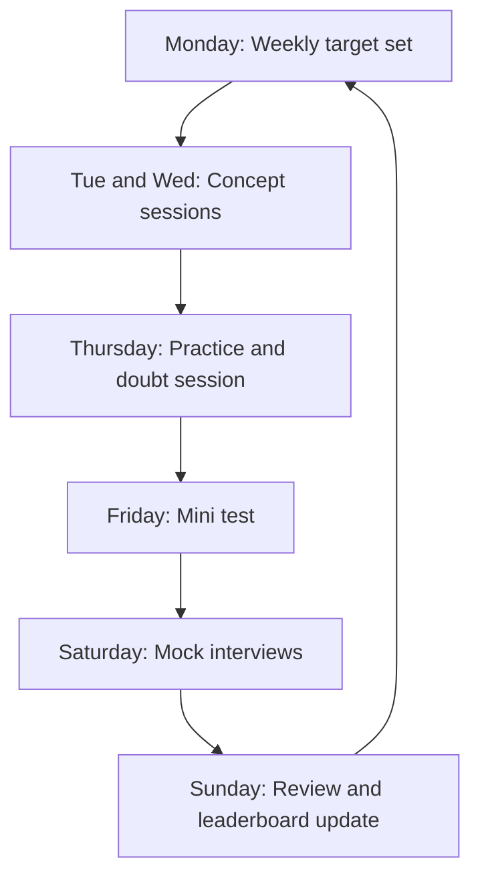

# Weekly Cycle

The rhythm stays the same every week so students always know what happens when.

| Day | Activity | Output |
|---|---|---|
| Monday | Goal setting | Weekly checklist |
| Tuesday and Wednesday | Concept sessions | Notes and practice set |
| Thursday | Practice and doubts | Solved problems |
| Friday | Mini test | Score |
| Saturday | Mock interviews | Written feedback |
| Sunday | Review | Progress report |

## Mentor Weekly Duties

1. Set and share the weekly target
2. Conduct or support concept and doubt sessions
3. Check the mini test and give score feedback
4. Run mock interviews and write feedback
5. Lead the accountability group check-in
6. Update the progress report

## Student Weekly Duties

1. Complete the weekly checklist
2. Attend sessions and the mock interview
3. Act on written feedback
4. Join the accountability group check-in

## Review Meeting (Sunday)

| Item | Detail |
|---|---|
| Attendance | Sessions and mocks attended |
| Assignments | Completion rate |
| Mini test | Score trend |
| Mock rating | Change from previous week |
| Next week | Targets and support needed |
