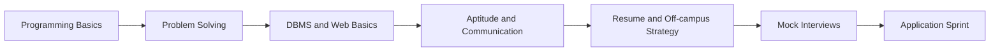

# Track: BCA/MCA

**Target:** BCA and MCA students
**Mantra:** Pehle base strong, phir speed.

## Flow

## Phases

| Phase | What happens | Deliverable |
|---|---|---|
| Programming Basics | Become strong in one language | Practice problems |
| Problem Solving | Concept-first DSA | Weekly tracker |
| DBMS and Web | SQL and basic web concepts | Mini project |
| Aptitude and Communication | Timed aptitude, self-introduction, confidence building | Recorded introduction |
| Resume and Off-campus | ATS-friendly resume, LinkedIn, referral approach | Resume and application plan |
| Mock Interviews | Technical and HR practice | Feedback sheet |
| Application Sprint | Off-campus applications and referrals | Application log |

## Why a Separate Track

BCA/MCA students often start with different foundations and have fewer on-campus opportunities. The track builds fundamentals first and puts extra weight on communication and off-campus strategy.

## Off-campus Strategy

| Step | Action |
|---|---|
| 1 | Build a focused resume and LinkedIn profile |
| 2 | Prepare a target company list by role type |
| 3 | Learn referral outreach etiquette |
| 4 | Track applications in a log and review weekly |

## Exit Criteria

1. Comfortable solving basic and intermediate problems in one language
2. Recorded self-introduction reviewed and improved
3. Mini project explained clearly
4. Application log started with weekly targets

## Notes

Content depth is adjusted using baseline results. Students who start stronger can move faster toward the CS/IT problem set.
