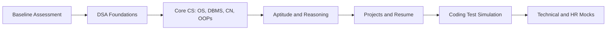

# Track: CS/IT

**Target:** B.Tech CS, IT and allied branches
**Focus:** DSA, core CS, projects and interviews

## Flow

## Phases

| Phase | What happens | Deliverable |
|---|---|---|
| Baseline | Diagnostic test on DSA, core CS and aptitude | Baseline report |
| DSA Foundations | Graded practice from arrays to graphs | Problem tracker |
| Core CS | Interview-style questions on OS, DBMS, Networks, OOPs | Revision notes |
| Aptitude | Timed tests | Score improvement report |
| Projects | Practice explaining projects clearly | Polished project pitch |
| Coding Test Simulation | Timed online-assessment style tests | Test analysis |
| Mocks | Technical and HR rounds | Feedback sheet |

## DSA Progression

| Stage | Topics |
|---|---|
| 1 | Arrays, strings, hashing |
| 2 | Recursion, sorting, searching |
| 3 | Linked lists, stacks, queues |
| 4 | Trees and heaps |
| 5 | Graphs, dynamic programming basics |

## Core CS Coverage

| Subject | Interview focus |
|---|---|
| Operating Systems | Processes, threads, scheduling, memory, deadlocks |
| DBMS | Normalization, transactions, indexing, SQL |
| Computer Networks | OSI and TCP/IP, HTTP, DNS |
| OOPs | Pillars, design thinking, language-specific questions |

## Exit Criteria

1. Final assessment score improved over baseline
2. At least a set number of mock interviews completed (decide with mentors)
3. Resume and project pitch reviewed by a mentor
4. Application plan prepared

## Mentor Notes

Add company-wise interview experiences to the Placement Playbook, after verification.
