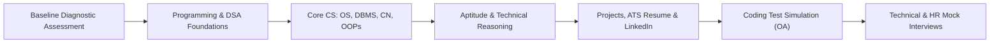

# Combined Tech Track: CS/IT, BCA, and MCA

> **Stream Note (ADR 0002):** CS/IT, BCA, and MCA students run **combinely** in this unified tech track. The track accommodates varying initial baselines (with foundation-leveling for BCA/MCA and early starters) and scales through Lead Teacher masterclasses and 24/7 AI-driven assistance.

**Target:** B.Tech CS/IT, BCA, and MCA students (majorly 2nd and 3rd year, plus select 4th and 1st year).  
**Focus:** Programming foundations, DSA, core CS, web/system projects, timed coding assessments, and interview rounds.

## Unified Flow

## Leveling & Pacing (CS/IT vs BCA/MCA)

To successfully run CS/IT and BCA/MCA students together:
1. **Diagnostic Baseline:** All students take an initial coding test.
2. **Foundational Ramp-up:** Students needing language syntax and problem-solving basics (common in BCA or 1st/2nd years) utilize the AI Assistant for accelerated daily drills before diving into complex DSA.
3. **Unified Live Lectures:** Concept masterclasses by the Lead Teacher focus on core data structures, algorithmic intuition, and problem-solving patterns applicable to all tech hiring rounds.
4. **Adaptive Practice Sets:** Practice sets contain standard (Tier 1/Tier 2 company) and stretch (Tier 1 product/top startup) problems, allowing students to progress at their own pace.

## Phases

| Phase | What happens | Deliverable |
|---|---|---|
| Baseline | Diagnostic test on programming, basic DSA, core CS and aptitude | Personalized baseline skill report |
| DSA Foundations | Graded practice from arrays and hashing to dynamic programming | Solved problem tracker with AI hints |
| Core CS | High-frequency interview concepts in OS, DBMS, Networks, OOPs | Core revision sheets & SQL query sets |
| Aptitude | Timed aptitude tests & company pattern analysis | Aptitude percentile improvement report |
| Projects & Resume | ATS-friendly resume formatting and deep-dive project pitch | Polished resume and GitHub project walk-through |
| Coding Test Simulation | Weekly timed online-assessment (OA) platform simulations | Time-management & test accuracy log |
| Mocks | 1-on-1 weekend technical and HR mock interviews | Standardized rubric scorecard & written feedback |

## DSA Progression

| Stage | Topics |
|---|---|
| 1 | Arrays, strings, hashing |
| 2 | Recursion, sorting, searching |
| 3 | Linked lists, stacks, queues |
| 4 | Trees and heaps |
| 5 | Graphs, dynamic programming basics |

## Core CS Coverage

| Subject | Interview focus |
|---|---|
| Operating Systems | Processes, threads, scheduling, memory, deadlocks |
| DBMS | Normalization, transactions, indexing, SQL |
| Computer Networks | OSI and TCP/IP, HTTP, DNS |
| OOPs | Pillars, design thinking, language-specific questions |

## Exit Criteria

1. Final assessment score improved over baseline
2. At least a set number of mock interviews completed (decide with mentors)
3. Resume and project pitch reviewed by a mentor
4. Application plan prepared

## Mentor Notes

Add company-wise interview experiences to the Placement Playbook, after verification.
