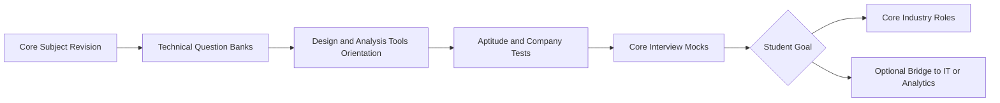

# Track: Mechanical

**Target:** B.Tech Mechanical
**Why it matters:** Few players serve this segment, so this is our most distinctive track.

## Flow

## Phases

| Phase | What happens | Deliverable |
|---|---|---|
| Core Revision | Thermodynamics, Fluid Mechanics, SOM, Manufacturing, Machine Design, Heat Transfer | Subject-wise notes |
| Question Banks | Interview-style technical questions per subject | Practice sets |
| Tools Orientation | Introduction to CAD and simulation tools | Small design exercise |
| Aptitude and Company Tests | Technical aptitude and screening patterns | Practice test series |
| Core Mocks | Role-based interview practice | Feedback sheet |
| Bridge Module | Excel, SQL and basic analytics | Optional certificate of completion |

## Core Subject Coverage

| Subject | Interview focus |
|---|---|
| Thermodynamics | Laws, cycles, engines |
| Fluid Mechanics | Flow, pumps, turbines |
| Strength of Materials | Stress, strain, beams |
| Manufacturing | Machining, casting, welding |
| Machine Design | Gears, shafts, bearings, failure theories |
| Heat Transfer | Conduction, convection, radiation |

## Role Paths

| Goal | Preparation emphasis |
|---|---|
| Core industry roles | Subject depth, design tools, plant and process awareness |
| Bridge to IT or analytics | Excel, SQL, basic analytics, aptitude and communication |

## Exit Criteria

1. Subject-wise revision notes completed
2. Practice test series completed with score review
3. Role-based mock interviews done with written feedback
4. Optional bridge module completed if chosen

## Risks and Mitigation

| Risk | Mitigation |
|---|---|
| Smaller audience | Targeted outreach through colleges and communities |
| Variation in core roles | Role-based mocks and mentor guidance |
| Tool access limits | Prefer free or student versions, confirm licensing |
