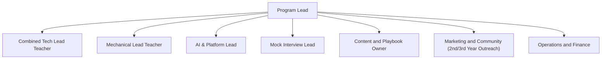

# Team Roles

Replace the placeholder owners with real names and GitHub usernames.

## Roles and Responsibilities

| Role | Responsibilities | Owner |
|---|---|---|
| Program Lead | Overall direction, cross-track alignment, quality control | TBD |
| Combined Tech Lead Teacher | CS/IT, BCA, and MCA unified curriculum, live masterclasses, problem sets | TBD |
| Mechanical Lead Teacher | Mechanical curriculum, core live lectures, company test simulations | TBD |
| AI & Platform Lead | AI Assistant configuration, 24/7 doubt bot, automated evaluation tools | TBD |
| Mock Interview & Evaluator Lead | Mock interviewer recruitment, weekend slot allocation, rubric consistency | TBD |
| Content and Playbook Owner | Placement Playbook, company-specific test questions, feedback rubrics | TBD |
| Marketing and Community | College outreach (focusing on 2nd & 3rd years), social presence, webinars | TBD |
| Operations and Finance | Cohort registration (250–300 seats), payment collection, compliance | TBD |

## Structure

## Working Agreements

1. Weekly team sync to review metrics and blockers
2. Decisions recorded as ADRs
3. Each role has a named backup
4. Changes to docs go through pull requests

## Mentor Roster

Keep mentor names, contact details and availability in a private, access-controlled place, not in this repository.
