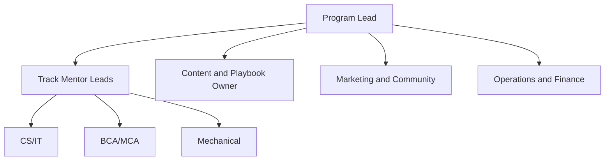

# Team Roles

Replace the placeholder owners with real names and GitHub usernames.

## Roles and Responsibilities

| Role | Responsibilities | Owner |
|---|---|---|
| Program Lead | Overall direction, final decisions, track allocation | TBD |
| CS/IT Mentor Lead | CS/IT curriculum, mentors, quality | TBD |
| BCA/MCA Mentor Lead | BCA/MCA curriculum, mentors, quality | TBD |
| Mechanical Mentor Lead | Mechanical curriculum, mentors, quality | TBD |
| Content and Playbook Owner | Placement Playbook, question banks, feedback formats | TBD |
| Marketing and Community | Content, outreach, free sessions, referrals | TBD |
| Operations and Finance | Registration, payments, compliance, tools | TBD |

## Structure

## Working Agreements

1. Weekly team sync to review metrics and blockers
2. Decisions recorded as ADRs
3. Each role has a named backup
4. Changes to docs go through pull requests

## Mentor Roster

Keep mentor names, contact details and availability in a private, access-controlled place, not in this repository.
